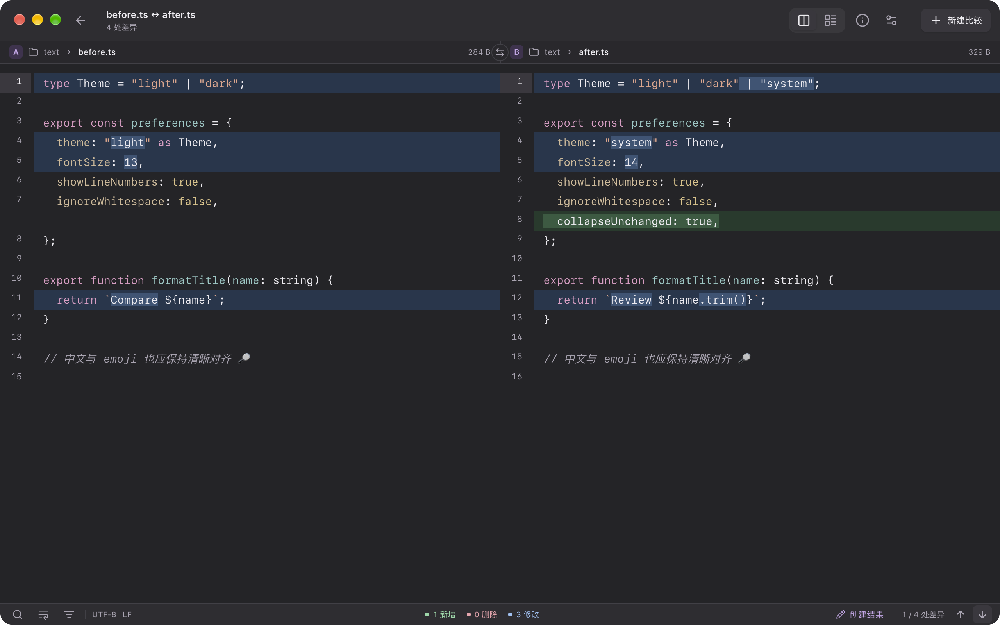
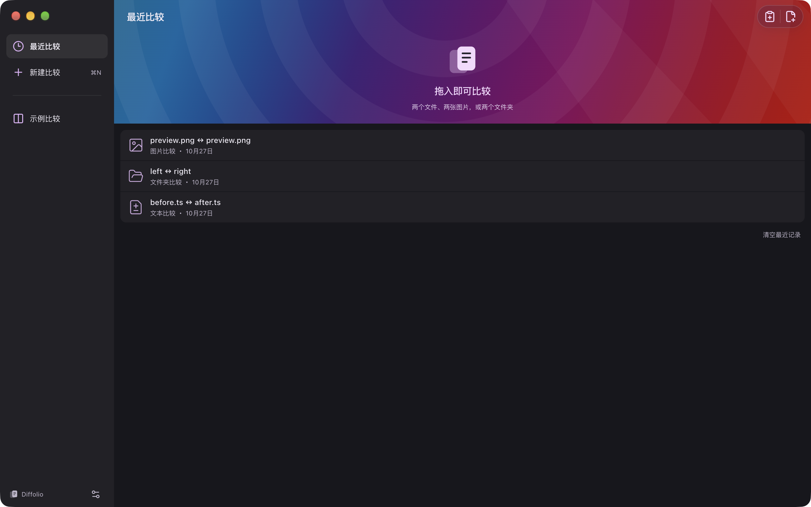
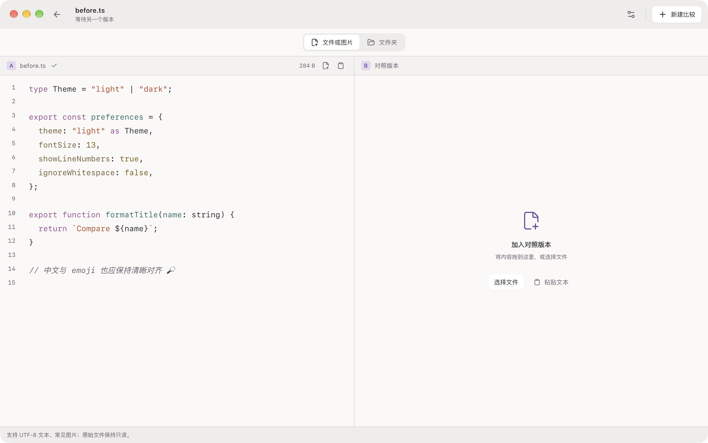
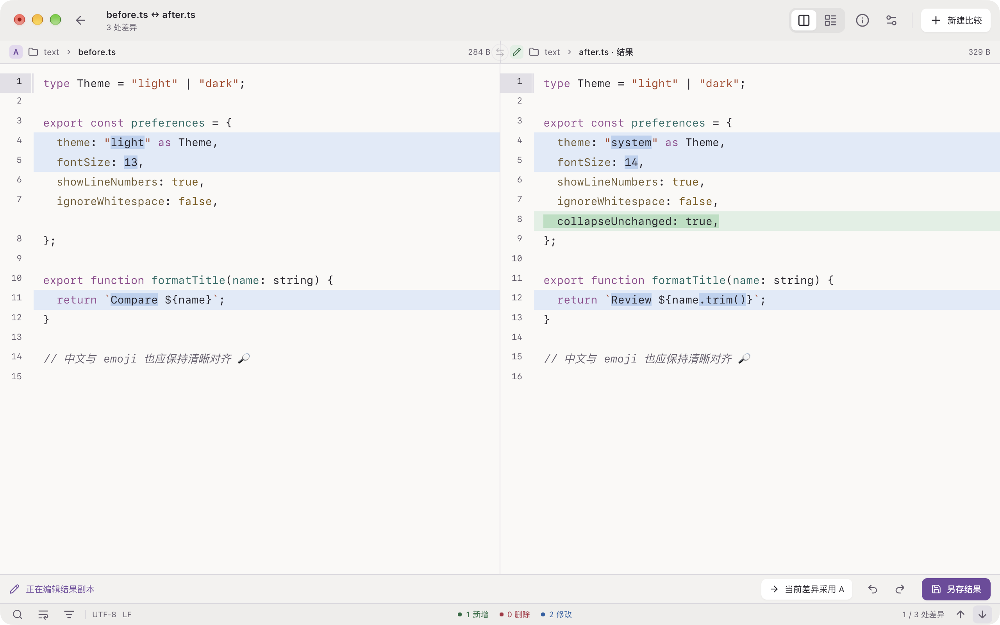
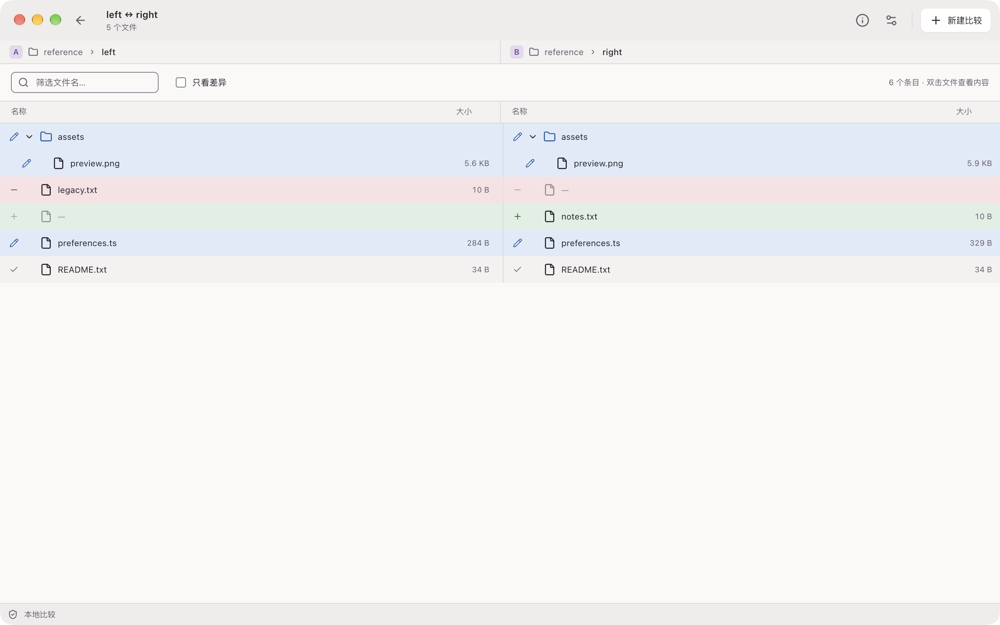
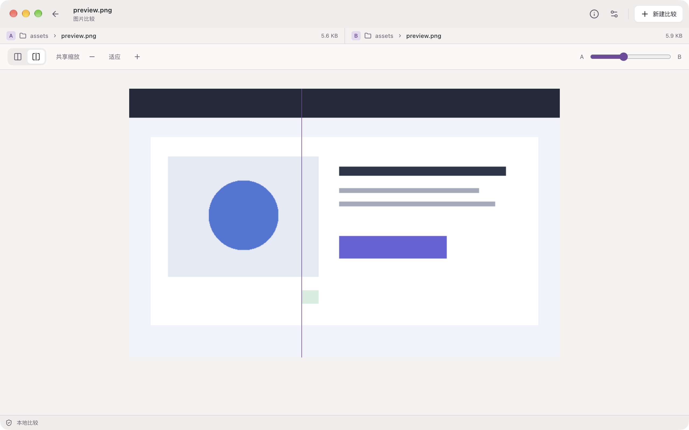
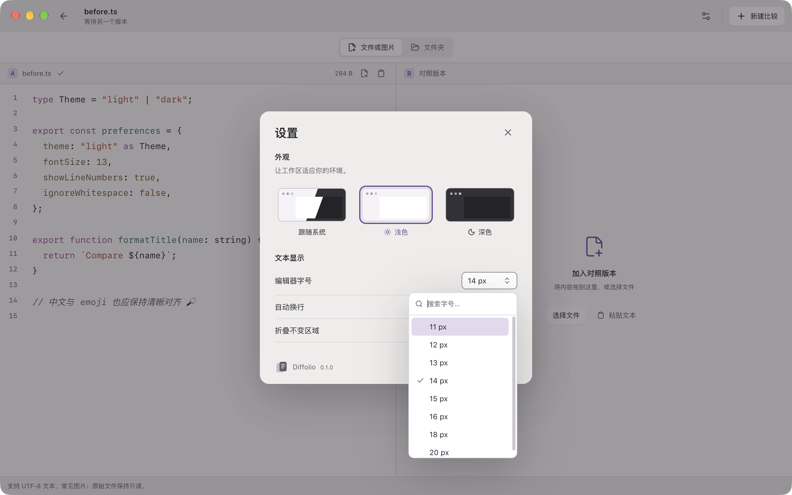

  
  <h1>Diffolio</h1>
  

    <a href="README.md"><strong>English</strong></a> · <a href="README.zh-CN.md">简体中文</a>
  

  
A considered file comparison workspace for macOS.

  

    <a href="#features">Features</a> ·
    <a href="#screenshots">Screenshots</a> ·
    <a href="#installation">Installation</a> ·
    <a href="#usage">Usage</a> ·
    <a href="#license">License</a>
  

  
v0.1.0 · macOS · Apple Silicon (arm64)

Diffolio compares local text files, folders and images in a compact desktop window. Open two versions, inspect their differences, and create an editable result when you need one. Compared inputs open read-only; saving a result is an explicit action.

Diffolio runs on macOS with Apple Silicon and currently has a **Simplified Chinese** interface.

## Features

- **Text comparison** — side-by-side and unified layouts, syntax highlighting, line and inline differences, change navigation, search, wrapping and unchanged-region folding.
- **Flexible input** — choose files, drop them into A/B independently, or add clipboard text. The first source opens immediately as a read-only preview; adding a compatible second source starts comparison.
- **Editable results** — create a result copy from B, apply the current change from A, edit manually, undo or redo across layout switches, and save through the native Save As dialog. Saving preserves B's UTF-8 BOM and line-ending convention and checks the destination for external changes.
- **Folder comparison** — compare contents, browse aligned directory trees, filter names or show only differences, and open a file with a double-click or the keyboard. Choose the two folders from separate locations; inspect progress or cancel a scan.
- **Image comparison** — view PNG, JPEG, WebP and GIF files side by side, share zoom and pan, fit the canvas, and use a wipe slider for images with matching dimensions.
- **Comparison sessions** — switch between multiple comparisons with tabs, reopen recent file pairs, and return to the welcome screen without losing the current result edits or undo history.
- **Desktop appearance** — system, light and dark workspace modes, adjustable editor size, compact native window controls and a separate welcome screen. The app icon includes native default, dark and tinted appearances.

- **Manual updates** — check from the Diffolio menu or settings, choose when to download, then restart to install. Unsaved results prevent installation.

## Screenshots

Explore text, folder and image comparisons in light and dark workspaces.

**Text comparison** — read both versions across the full window, with stable colors for additions, deletions and modifications.

Welcome and recent comparisons

Start from the drop area, choose files, or reopen a recent pair. Navigation stays on the welcome screen so documents can use the full comparison window.

Add two sources and preview the first

Choose or paste into each side separately. The first file becomes a read-only preview while the other side waits for input. Folder mode provides independent location pickers.

Edit a result in the light workspace

Create a result from B, take a change from A, and review the result before saving. The result label, undo controls and Save As action stay visible.

Compare folders

Review modified, equal and unmatched entries in aligned trees, then open individual files to inspect their contents.

Compare images

Slide the divider between two matching-size sample images. Side-by-side viewing is also available, including for images with different dimensions.

Appearance and editor preferences

Choose system, light or dark appearance and adjust editor size with the searchable font-size control. Preferences are saved on this Mac.

## Installation

Download the macOS Apple Silicon (arm64) build from [Releases](https://github.com/svn-box/diffolio/releases). Open the DMG and drag Diffolio to Applications, or extract the ZIP and move the app there.

See the [0.1.0 release notes](docs/releases/0.1.0.md) for features and supported formats.

## Usage

### Open two versions

Press **⌘N** to start a comparison, or **⌘O** to select one or two files. You can also drop two files into the window, drop them into A/B separately, or use the clipboard actions. Opening files one at a time fills the missing side. Text and image sources must be paired with the same content type.

The welcome screen's **示例比较** (Example Comparison) opens a clearly labeled text example. Recent entries reopen their actual paths from disk.

### Inspect and save a result

Use the arrow controls to move between changes, **⌘F** to search, and **⌘1 / ⌘2** to choose side-by-side or unified layout. Wrapping and folding controls are in the bottom bar.

Choose **创建结果** (Create Result) to make B editable. **当前差异采用 A** applies the currently indicated change from A. You can also edit directly and undo or redo. **另存结果** (Save Result As), **⌘S** or **⌘⇧S** opens the native save dialog; choose the destination deliberately. Closing a modified result offers save, discard and cancel actions.

### Search the comparison

Press **⌘F** to open the shared search bar, then choose **A** or **B**. Use **Enter / ⇧Enter** or **⌘G / ⌘⇧G** to move between matches. Search options include case sensitivity, whole words, and regular expressions. Matching folded text is revealed automatically; **Escape** or **Done** closes search. Unified layout searches B or your editable result.

### Check for updates

Choose **Diffolio → 检查更新…** (Check for Updates), or open **Settings → 应用更新** (App Updates). Checking, downloading, and restarting are separate actions you control. Save every edited result and wait for active tasks to finish before installing. File contents stay on this Mac; update requests access the public GitHub release service.

### Compare folders and images

Press **⌘⇧O** or choose folder mode in a new comparison, then select A and B independently. Filter the tree by name, enable differences-only filtering, and double-click a file or focus it and press **Enter / Space** to open it.

Open two supported images through the same file inputs. Use side-by-side mode, or the wipe control when their dimensions match, then adjust zoom or return to fit.

### Keep your place

Use the return arrow to visit recent comparisons and **继续比较** (Continue Comparison) to resume the current session. Multiple sessions appear as tabs. Open sessions and unsaved result drafts live in the current application session; recent path pairs and preferences persist across restarts.

### Keyboard shortcuts

| Shortcut | Action                             |
| -------- | ---------------------------------- |
| ⌘N       | New comparison                     |
| ⌘O       | Open files                         |
| ⌘⇧O      | Start folder comparison            |
| ⌘1 / ⌘2  | Side-by-side / unified text layout |
| ⌘F       | Find in the text comparison        |
| ⌘G / ⌘⇧G | Next / previous search match       |
| ⌘Z / ⌘⇧Z | Undo / redo result edits           |
| ⌘S / ⌘⇧S | Save result as…                    |
| ⌘W       | Close the current comparison       |
| ⌘,       | Open settings                      |

## Supported files and limits

Text input supports **UTF-8**, including BOM and LF, CRLF or CR line endings. Opened text/image files and saved results are limited to **16 MiB per file**; folder scans are limited to **100,000 entries**. Symlink entries are compared as links rather than followed during directory traversal.

## License

Diffolio uses the custom [Diffolio Source Available License 1.0](LICENSE). Personal use and internal use by companies of any size are free, including commercial work. You may modify the app and share original or modified copies free of charge, preserving the license and notices and identifying changes.

Selling the app or a modified version, including renamed or repackaged copies, requires separate written permission. Files and work you create or compare with Diffolio remain yours. This is a source-available project with a resale restriction. Third-party components retain their original licenses; see [third-party notices](THIRD_PARTY_NOTICES.md).
