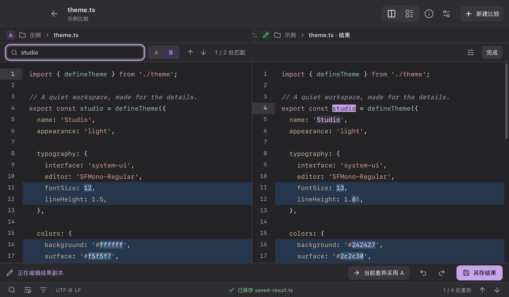

  
  <h1>Diffolio</h1>
  
为细节留出空间的 macOS 文件比较工具。

  
<a href="README.md">English</a> · <strong>简体中文</strong>

  
Tauri 预览版 · macOS 13.3+ · Apple Silicon

在紧凑的桌面窗口中比较本地文本、文件夹和图片，保留清晰、安静的阅读与编辑体验。

## 功能

- **文本比较**：双栏和统一布局、语法高亮、行内差异、差异导航、长行换行和不变区域折叠。
- **搜索**：统一搜索栏、A/B 范围切换、前后匹配项、区分大小写、完整单词和正则表达式。
- **编辑结果**：从 B 创建结果副本、采用 A 的当前差异、手动编辑、跨布局撤销/重做，保存时保留原有 BOM 和换行格式，并检查目标是否被外部程序修改。
- **文件夹比较**：根据实际内容判断差异，按名称或差异筛选、打开配对文件、查看进度和取消扫描。
- **图片比较**：支持 PNG、JPEG、WebP、GIF，共享缩放与拖动，同尺寸图片支持分割滑块。
- **工作区**：多标签、最近记录、原生文件对话框、Finder 拖放、剪贴板文本、浅色/深色/跟随系统外观，以及可调字号。

## 界面预览

## 安装与使用

本版本目前为本地预览版。打开提供的 Diffolio DMG，将应用拖入“应用程序”；也可以直接打开提供的 Diffolio.app。预览版使用独立的设置和最近记录，不与 Electron 版共享数据。

将两个文件或文件夹拖入窗口，分别向 A/B 加入内容，或者先打开内置示例。原始版本以只读方式打开；点击“创建结果”进行编辑，点击“另存结果”保存。

常用快捷键：⌘N 新建比较、⌘O 打开文件、⌘F 搜索、⌘G / ⇧⌘G 切换匹配项、⌘1 / ⌘2 切换布局、⌘, 打开设置。

此本地预览版尚未完成公开分发所需的公证；独立更新渠道就绪前，请手动安装新版本。支持 UTF-8 文本，单文件上限 16 MiB，文件夹扫描上限 100,000 个条目。

## 隐私

文件内容在本机处理，无需账号，也无需上传文件。

## 许可

Diffolio 使用 [Diffolio Source Available License 1.0](LICENSE)。个人及公司内部均可免费使用，也可以用于有偿工作。遵守声明要求时可免费分发；出售、对软件访问收费，或改名、重新打包后销售，需要另行获得书面许可。第三方依赖保留原有许可，详见[第三方声明](THIRD_PARTY_NOTICES.md)。
